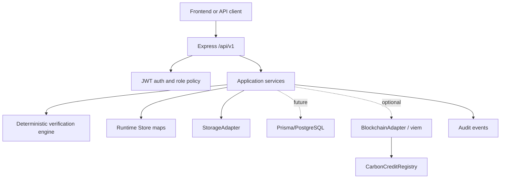

# Architecture

CarbonProof AI is a modular-monolith prototype. The HTTP layer is Express 5;
domain behavior is kept in `src/service.ts` and the framework-independent
verification engine in `src/verification/`.

## Runtime boundaries

- `src/app.ts` owns routes, request parsing, response envelopes, middleware,
  authorization checks, and error mapping.
- `src/service.ts` owns project, evidence, assessment, review, credit, and audit
  use cases. It does not receive raw HTTP request objects.
- `src/storage.ts` defines the storage interface and local filesystem adapter.
- `src/repository.ts` selects native in-memory Maps or the Prisma-backed store;
  `src/prisma-store/` constructs `PrismaClient` and hydrates/persists the domain
  collections when `USE_IN_MEMORY=false`.
- `src/blockchain/` defines a viem adapter, disabled adapter, ABI, validation,
  reads, writes, and receipt confirmation. The current API routes do not invoke
  it; this is an explicit integration gap documented in the final audit.

## Transaction boundaries

The in-memory prototype applies each service mutation synchronously. The current
Prisma adapter queues upserts for compatibility; production hardening should add
explicit database transactions for assessment persistence, idempotency records,
and credit quantity updates, but must never hold a database transaction open
while waiting for an RPC receipt. Blockchain submission, confirmation, and
reconciliation are separate state transitions.

## Trust boundaries

Uploaded bytes, filenames, source URLs, user-supplied hashes, registry
references, and structured claims are untrusted input. SHA-256 is computed from
server-read bytes; user-provided hashes are never authoritative. The risk score
prioritizes review and is not a probability of fraud or scientific validation.
