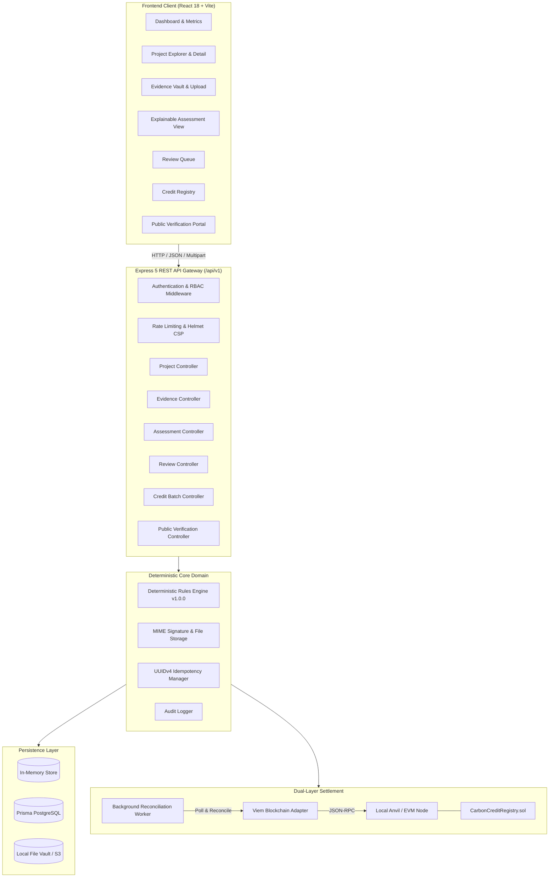

# CarbonProof AI — Architecture Specification

## 1. System Overview

CarbonProof AI provides an end-to-end evidence-first verification engine for Voluntary Carbon Markets (VCMs). It replaces ambiguous, manual document inspection with deterministic scoring, cryptographic hashing, auditability, separation of duties, and dual-layer blockchain settlement.

---

## 2. Key Architectural Subsystems

### A. Client Presentation Layer (`frontend/`)
- Built with React 18, TypeScript, Tailwind CSS, TanStack Query, and React Hook Form.
- Adheres to Claude-inspired editorial design: warm neutrals (`#FBFBF9`), forest green accents (`#2D5A43`), high-contrast typography, and explicit status labeling (no color-alone indicators).
- Enforces client-side role-based routing guards: `CONTRIBUTOR`, `REVIEWER`, `ADMIN`, `PUBLIC`.
- Integrates with the backend REST API via a typed fetch client that injects Bearer tokens and handles automatic multipart boundary boundaries.

### B. API Gateway & Security Layer (`src/app.ts`, `src/auth.ts`)
- Express 5 with native ESM imports.
- Global rate-limiting (`express-rate-limit`) and security headers (`helmet`).
- Structured logging using `pino` with request correlation IDs (`x-correlation-id`).
- Authentication using salted `bcryptjs` password hashes and signed JWT tokens with strict issuer (`carbonproof-ai`) and audience (`carbonproof-api`) validation.

### C. Deterministic Verification Rules Engine (`src/verification/`)
- Executes immutable, versioned rules against submitted project data and evidence items.
- Standard Rules evaluated:
  1. `RULE_ADDITIONALITY_FINANCIAL`: Validates investment hurdle rate and financial additionality assertions.
  2. `RULE_BASELINE_CREDIBILITY`: Checks historical emissions baselines and deforestation rates.
  3. `RULE_EVIDENCE_PROVENANCE`: Ensures required remote-sensing and ground-truth evidence attachments exist.
  4. `RULE_LEAKAGE_MITIGATION`: Evaluates activity-shifting leakage risk and buffer mechanisms.
  5. `RULE_BUFFER_POOL_ADEQUACY`: Validates risk reserve allocations against reversal risks.
- Produces deterministic scores (0-100) and itemized findings with severity ratings (`CRITICAL`, `HIGH`, `MEDIUM`, `LOW`, `INFO`).

### D. Cryptographic Evidence Vault (`src/storage.ts`)
- Content-addressed file storage using SHA-256 digests.
- File integrity inspection via binary magic number signature detection (PDF, PNG, JPEG, GeoTIFF, CSV).
- Real-time on-chain and ledger hash comparison preventing retroactive document tampering.

### E. Credit Registry & Dual-Layer Settlement (`src/service.ts`, `contracts/`)
- All batch issuance and retirement requests enforce UUIDv4 `Idempotency-Key` headers to prevent double-minting or double-burning across network retries.
- Dual-Layer Architecture:
  - **Layer 1 (Off-Chain Relational/Memory Ledger)**: High-throughput, granular project attributes, reviewer comments, and audit trail.
  - **Layer 2 (On-Chain EVM Smart Contract)**: Immutable evidence fingerprint anchor (`registerEvidence`), credit issuance records (`issueCredits`), and burned retirement certificates (`retireCredits`).

### F. Blockchain Reconciliation Worker (`src/blockchain/reconciliation.ts`)
- Asynchronous worker monitoring pending blockchain transactions.
- Implements bounded exponential backoff retries.
- Detects on-chain vs off-chain state divergence, flags stale intents, and updates local transaction status upon receipt confirmation.
